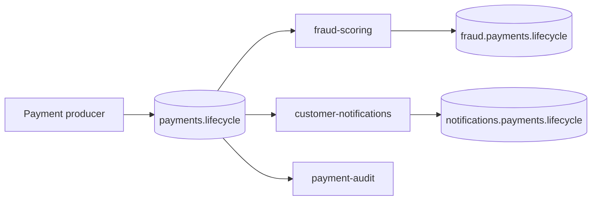

# Digital Payments Event Streaming POC

## 1. Design Decisions

### Architecture

The payment producer writes the full lifecycle to `payments.lifecycle`. The fraud-scoring and customer-notification consumers each use an independent consumer group to read that topic. Fraud scores and notification outcomes are published to their own topics. The payment-audit group independently reads the payment lifecycle for reconciliation and audit.



### Topic Configuration

| Topic | Partitions | Replication factor | Retention | Cleanup | Purpose |
|---|---:|---:|---|---|---|
| `payments.lifecycle` | 100 | 3 | 7 years (`220752000000` ms) | `delete` | Immutable payment lifecycle and audit events |
| `fraud.payments.lifecycle` | 100 | 3 | 7 years (`220752000000` ms) | `delete` | Fraud score events retained for replay and audit |
| `notifications.payments.lifecycle` | 100 | 3 | 30 days (`2592000000` ms) | `delete` | Notification outcomes retained for operational replay |

All three topics use `min.insync.replicas=2`, `compression.type=lz4`, and `max.message.bytes=1048576` (1 MiB).

- **Partitions:** 100 provides parallelism for the stated peak target of 1000 Mb/s if each consumer instance handles approximately 10 Mb/s. It also permits up to 100 active consumers per group. This is a capacity assumption, not a measured result; 100 partitions per topic may be excessive for a small local cluster, so validate resource use during the POC.
- **Replication and durability:** Replication factor 3 with minimum ISR 2 and producer `acks=all` tolerates one broker failure while at least two replicas remain in sync. It does not guarantee zero data loss in every failure scenario. The cluster must have at least three brokers to create these topics.
- **Retention:** Payment and fraud records use seven years to satisfy the stated audit requirement. Notification output uses 30 days for operational replay; if these notification records are themselves subject to the seven-year legal hold, increase this setting and plan storage accordingly.
- **Cleanup:** `delete` is appropriate for append-only event history. Compaction is not used because lifecycle events are facts to retain, not replaceable keyed state.
- **Size limits:** A 1 MiB maximum accommodates event envelopes while bounding unusually large records. Keep payloads small and store large documents elsewhere.
- **Compression:** LZ4 reduces network and disk use with low compression/decompression latency, which suits the real-time targets. Measure CPU and compression ratio in the target cluster.
- **Time and size retention:** No `retention.bytes` limit is set because a size cap could delete records before the required seven-year period. Capacity planning and archival are required to sustain that hold.

### Event Schema and Key

Use JSON values with one event per record. The Kafka key is the stable `paymentId`; all events for a payment must use the same key so Kafka routes them to the same partition and preserves their order within that partition.

| Field | Type | Description |
|---|---|---|
| `eventId` | string (UUID) | Unique event identifier for deduplication |
| `eventType` | string | Lifecycle event name, such as `PAYMENT_INITIATED` |
| `eventVersion` | integer | Schema version for evolution |
| `paymentId` | string | Payment identifier; also the Kafka record key |
| `occurredAt` | string (UTC ISO 8601) | Time the business event occurred |
| `amount` | string decimal | Amount represented without floating-point rounding |
| `currency` | string | ISO 4217 currency code |
| `paymentType` | string | Payment rail/type, for example `CARD` or `EFT` |
| `channel` | string | Origin channel, for example `MOBILE` or `WEB` |
| `customerRef` | string | Tokenized or non-sensitive customer reference; never raw card data |
| `merchantId` | string | Merchant or beneficiary reference, when applicable |
| `status` | string | Resulting payment state |
| `reasonCode` | string or null | Non-sensitive decline/failure reason, when applicable |
| `correlationId` | string | Identifier used to trace a payment across services |

Fraud output should additionally include `score` and `riskLevel`. Notification output should include `notificationType`, `deliveryStatus`, and a non-sensitive destination reference. Do not put PAN, CVV, credentials, or other sensitive authentication data in Kafka records.

### Payment Producer

The producer publishes these transitions to `payments.lifecycle`:

`PAYMENT_INITIATED` -> `PAYMENT_AUTHORIZED` or `PAYMENT_NOT_AUTHORIZED` -> `PAYMENT_VALIDATED` or `PAYMENT_INVALIDATED` -> `PAYMENT_COMPLETED` or `PAYMENT_NOT_COMPLETED`.

Use `paymentId` as the key. `acks=all`, idempotence, and retries protect against transient broker/network failures and duplicate appends caused by producer retries. Idempotence does not deduplicate separate business requests; use a stable `eventId` and application-level idempotency checks as well. A production producer should surface failure after its delivery timeout and use an outbox/reconciliation strategy rather than silently dropping a payment event.

JSON is selected for this POC because it is readable in console tools and easy to inspect. Avro or Protobuf with schema management would be preferable if compactness, strict compatibility checks, or multi-team evolution becomes a requirement.

### Consumer Groups and SLAs

| Group | Reads | Work and filtering | Target lag |
|---|---|---|---|
| `fraud-scoring` | `payments.lifecycle` | Process `PAYMENT_INITIATED`, calculate a risk score, publish low/medium/high events to `fraud.payments.lifecycle` | Under 50 ms |
| `customer-notifications` | `payments.lifecycle` | Process `PAYMENT_VALIDATED` and failure outcomes; send the customer notification and publish approved/failed outcomes to `notifications.payments.lifecycle` | Under 2 s |
| `payment-audit` | `payments.lifecycle` | Independently retain/process all lifecycle events for reconciliation and audit | Under 1 hour (POC target; no stricter audit lag is specified) |

The groups are independent: each receives its own copy of the stream and can scale separately up to the topic partition count. Filtering is application logic; `kafka-console-consumer` displays records but does not implement fraud scoring, filtering, or notification delivery.

For application consumers, commit offsets after successful processing. Fraud and audit processing should be idempotent using `eventId`. For notification delivery, use an idempotency key and retry policy because a crash after sending but before committing can cause a repeat. Kafka transactions can atomically write an output event and commit consumed offsets, but they cannot make an external SMS/email delivery exactly once.

## 2. Topic Creation

Run the following inside the provided cluster. The replication factor requires at least three brokers.

```bash
kubectl exec -it kafka-0 -- kafka-topics \
  --bootstrap-server kafka-service:9092 \
  --create \
  --topic payments.lifecycle \
  --partitions 100 \
  --replication-factor 3 \
  --config retention.ms=220752000000 \
  --config cleanup.policy=delete \
  --config min.insync.replicas=2 \
  --config compression.type=lz4 \
  --config max.message.bytes=1048576

kubectl exec -it kafka-0 -- kafka-topics \
  --bootstrap-server kafka-service:9092 \
  --create \
  --topic fraud.payments.lifecycle \
  --partitions 100 \
  --replication-factor 3 \
  --config retention.ms=220752000000 \
  --config cleanup.policy=delete \
  --config min.insync.replicas=2 \
  --config compression.type=lz4 \
  --config max.message.bytes=1048576

kubectl exec -it kafka-0 -- kafka-topics \
  --bootstrap-server kafka-service:9092 \
  --create \
  --topic notifications.payments.lifecycle \
  --partitions 100 \
  --replication-factor 3 \
  --config retention.ms=2592000000 \
  --config cleanup.policy=delete \
  --config min.insync.replicas=2 \
  --config compression.type=lz4 \
  --config max.message.bytes=1048576
```

Verify each topic and capture the actual output:

```bash
kubectl exec -it kafka-0 -- kafka-topics --bootstrap-server kafka-service:9092 --describe --topic payments.lifecycle
kubectl exec -it kafka-0 -- kafka-topics --bootstrap-server kafka-service:9092 --describe --topic fraud.payments.lifecycle
kubectl exec -it kafka-0 -- kafka-topics --bootstrap-server kafka-service:9092 --describe --topic notifications.payments.lifecycle
```

**Execution evidence:** Not captured yet. Paste the actual describe output here after running these commands; do not treat the selected values above as proof that the topics were created.

## 3. Producer Setup

For the POC, use the console producer to enter keyed JSON records. The key separator is `:`; the key is the payment ID and the remaining line is the JSON value.

```bash
kubectl exec -it kafka-0 -- kafka-console-producer \
  --bootstrap-server kafka-service:9092 \
  --topic payments.lifecycle \
  --property parse.key=true \
  --property key.separator=: \
  --producer-property key.serializer=org.apache.kafka.common.serialization.StringSerializer \
  --producer-property value.serializer=org.apache.kafka.common.serialization.StringSerializer \
  --producer-property acks=all \
  --producer-property retries=2147483647 \
  --producer-property max.in.flight.requests.per.connection=5 \
  --producer-property enable.idempotence=true \
  --producer-property compression.type=lz4 \
  --producer-property linger.ms=5 \
  --producer-property batch.size=32768 \
  --producer-property delivery.timeout.ms=120000 \
  --producer-property request.timeout.ms=30000
```

Produce at least two journeys, including a success and a failure. Example records to enter at the producer prompt:

```text
PAY-1001:{"eventId":"e1001-1","eventType":"PAYMENT_INITIATED","eventVersion":1,"paymentId":"PAY-1001","occurredAt":"2026-10-30T09:00:00Z","amount":"125.50","currency":"ZAR","paymentType":"CARD","channel":"MOBILE","customerRef":"CUST-001","merchantId":"MER-100","status":"INITIATED","reasonCode":null,"correlationId":"CORR-1001"}
PAY-1001:{"eventId":"e1001-2","eventType":"PAYMENT_AUTHORIZED","eventVersion":1,"paymentId":"PAY-1001","occurredAt":"2026-10-30T09:00:01Z","amount":"125.50","currency":"ZAR","paymentType":"CARD","channel":"MOBILE","customerRef":"CUST-001","merchantId":"MER-100","status":"AUTHORIZED","reasonCode":null,"correlationId":"CORR-1001"}
PAY-1001:{"eventId":"e1001-3","eventType":"PAYMENT_VALIDATED","eventVersion":1,"paymentId":"PAY-1001","occurredAt":"2026-10-30T09:00:02Z","amount":"125.50","currency":"ZAR","paymentType":"CARD","channel":"MOBILE","customerRef":"CUST-001","merchantId":"MER-100","status":"VALIDATED","reasonCode":null,"correlationId":"CORR-1001"}
PAY-1001:{"eventId":"e1001-4","eventType":"PAYMENT_COMPLETED","eventVersion":1,"paymentId":"PAY-1001","occurredAt":"2026-10-30T09:00:03Z","amount":"125.50","currency":"ZAR","paymentType":"CARD","channel":"MOBILE","customerRef":"CUST-001","merchantId":"MER-100","status":"COMPLETED","reasonCode":null,"correlationId":"CORR-1001"}
PAY-1002:{"eventId":"e1002-1","eventType":"PAYMENT_INITIATED","eventVersion":1,"paymentId":"PAY-1002","occurredAt":"2026-10-30T09:01:00Z","amount":"850.00","currency":"ZAR","paymentType":"EFT","channel":"WEB","customerRef":"CUST-002","merchantId":"MER-200","status":"INITIATED","reasonCode":null,"correlationId":"CORR-1002"}
PAY-1002:{"eventId":"e1002-2","eventType":"PAYMENT_NOT_AUTHORIZED","eventVersion":1,"paymentId":"PAY-1002","occurredAt":"2026-10-30T09:01:01Z","amount":"850.00","currency":"ZAR","paymentType":"EFT","channel":"WEB","customerRef":"CUST-002","merchantId":"MER-200","status":"NOT_AUTHORIZED","reasonCode":"ISSUER_DECLINED","correlationId":"CORR-1002"}
```

These are sample records, not evidence that production has occurred. The two journeys cover one completed payment and one authorization failure. In a separate test, include `PAYMENT_INVALIDATED` or `PAYMENT_NOT_COMPLETED` to exercise those failure paths too. The fraud and notification output events should be produced by their respective application logic, not assumed to be generated by the payment producer.

For production-grade use, replace manual console entry with a producer that validates the schema, assigns stable event IDs, handles errors, and records actual broker acknowledgements. The console-producer settings are for demonstration and do not implement business-level deduplication.

## 4. Consumer Setup

Each group must be started as a separate consumer. The common settings below enable replay from the beginning for a new group and use bounded polling/fetch values as starting points. Adjust and load-test them against the real cluster. `--consumer-property` is accepted by the Kafka CLI versions targeted by the current setup notes; check the installed CLI version if an option is rejected.

### Fraud scoring smoke test

```bash
kubectl exec -it kafka-0 -- kafka-console-consumer \
  --bootstrap-server kafka-service:9092 \
  --topic payments.lifecycle \
  --property print.key=true \
  --property print.partition=true \
  --property print.offset=true \
  --property key.separator=: \
  --group fraud-scoring \
  --consumer-property key.deserializer=org.apache.kafka.common.serialization.StringDeserializer \
  --consumer-property value.deserializer=org.apache.kafka.common.serialization.StringDeserializer \
  --consumer-property max.poll.records=500 \
  --consumer-property session.timeout.ms=45000 \
  --consumer-property heartbeat.interval.ms=15000 \
  --consumer-property auto.offset.reset=earliest \
  --consumer-property enable.auto.commit=false \
  --consumer-property max.poll.interval.ms=300000 \
  --consumer-property fetch.min.bytes=1 \
  --consumer-property fetch.max.wait.ms=10 \
  --consumer-property max.partition.fetch.bytes=1048576 \
  --consumer-property partition.assignment.strategy=org.apache.kafka.clients.consumer.RangeAssignor
```

The real fraud consumer filters for `PAYMENT_INITIATED`, computes a score, and publishes one of `FRAUD_SCORE_LOW`, `FRAUD_SCORE_MEDIUM`, or `FRAUD_SCORE_HIGH` to `fraud.payments.lifecycle`. The console command only displays input records.

### Customer notification smoke test

```bash
kubectl exec -it kafka-0 -- kafka-console-consumer \
  --bootstrap-server kafka-service:9092 \
  --topic payments.lifecycle \
  --property print.key=true \
  --property print.partition=true \
  --property print.offset=true \
  --property key.separator=: \
  --group customer-notifications \
  --consumer-property key.deserializer=org.apache.kafka.common.serialization.StringDeserializer \
  --consumer-property value.deserializer=org.apache.kafka.common.serialization.StringDeserializer \
  --consumer-property max.poll.records=100 \
  --consumer-property session.timeout.ms=45000 \
  --consumer-property heartbeat.interval.ms=15000 \
  --consumer-property auto.offset.reset=earliest \
  --consumer-property enable.auto.commit=false \
  --consumer-property max.poll.interval.ms=300000 \
  --consumer-property fetch.min.bytes=1 \
  --consumer-property fetch.max.wait.ms=10 \
  --consumer-property max.partition.fetch.bytes=1048576 \
  --consumer-property partition.assignment.strategy=org.apache.kafka.clients.consumer.RangeAssignor
```

The application filters `PAYMENT_VALIDATED`, `PAYMENT_NOT_AUTHORIZED`, `PAYMENT_INVALIDATED`, and `PAYMENT_NOT_COMPLETED`. It sends the corresponding notification and publishes `FRAUD_PAYMENT_APPROVED` or `FRAUD_PAYMENT_FAILED` to `notifications.payments.lifecycle`. The console command does not filter or send notifications.

### Payment audit smoke test

```bash
kubectl exec -it kafka-0 -- kafka-console-consumer \
  --bootstrap-server kafka-service:9092 \
  --topic payments.lifecycle \
  --property print.key=true \
  --property print.partition=true \
  --property print.offset=true \
  --property key.separator=: \
  --group payment-audit \
  --consumer-property key.deserializer=org.apache.kafka.common.serialization.StringDeserializer \
  --consumer-property value.deserializer=org.apache.kafka.common.serialization.StringDeserializer \
  --consumer-property max.poll.records=500 \
  --consumer-property session.timeout.ms=45000 \
  --consumer-property heartbeat.interval.ms=15000 \
  --consumer-property auto.offset.reset=earliest \
  --consumer-property enable.auto.commit=true \
  --consumer-property auto.commit.interval.ms=5000 \
  --consumer-property max.poll.interval.ms=300000 \
  --consumer-property fetch.min.bytes=1 \
  --consumer-property fetch.max.wait.ms=10 \
  --consumer-property max.partition.fetch.bytes=1048576 \
  --consumer-property partition.assignment.strategy=org.apache.kafka.clients.consumer.RangeAssignor
```

The audit group reads all payment lifecycle events independently from the fraud and notification groups. A production audit processor should persist records to the audit store before committing offsets.

### Fraud and notification output smoke tests

These commands manually simulate the output of the fraud and notification applications. They do not prove that the applications consumed, scored, or delivered the corresponding payment events.

```bash
kubectl exec -it kafka-0 -- kafka-console-producer \
  --bootstrap-server kafka-service:9092 \
  --topic fraud.payments.lifecycle \
  --property parse.key=true \
  --property key.separator=: \
  --producer-property key.serializer=org.apache.kafka.common.serialization.StringSerializer \
  --producer-property value.serializer=org.apache.kafka.common.serialization.StringSerializer \
  --producer-property acks=all \
  --producer-property retries=2147483647 \
  --producer-property max.in.flight.requests.per.connection=5 \
  --producer-property enable.idempotence=true \
  --producer-property compression.type=lz4 \
  --producer-property linger.ms=5 \
  --producer-property batch.size=32768 \
  --producer-property delivery.timeout.ms=120000 \
  --producer-property request.timeout.ms=30000
```

Example fraud output record:

```text
PAY-1001:{"eventId":"f1001-1","eventType":"FRAUD_SCORE_LOW","eventVersion":1,"paymentId":"PAY-1001","occurredAt":"2026-10-30T09:00:01Z","score":12,"riskLevel":"LOW","correlationId":"CORR-1001"}
```

```bash
kubectl exec -it kafka-0 -- kafka-console-producer \
  --bootstrap-server kafka-service:9092 \
  --topic notifications.payments.lifecycle \
  --property parse.key=true \
  --property key.separator=: \
  --producer-property key.serializer=org.apache.kafka.common.serialization.StringSerializer \
  --producer-property value.serializer=org.apache.kafka.common.serialization.StringSerializer \
  --producer-property acks=all \
  --producer-property retries=2147483647 \
  --producer-property max.in.flight.requests.per.connection=5 \
  --producer-property enable.idempotence=true \
  --producer-property compression.type=lz4 \
  --producer-property linger.ms=5 \
  --producer-property batch.size=32768 \
  --producer-property delivery.timeout.ms=120000 \
  --producer-property request.timeout.ms=30000
```

Example notification output record:

```text
PAY-1001:{"eventId":"n1001-1","eventType":"FRAUD_PAYMENT_APPROVED","eventVersion":1,"paymentId":"PAY-1001","occurredAt":"2026-10-30T09:00:02Z","notificationType":"PAYMENT_APPROVED","deliveryStatus":"QUEUED","destinationRef":"CUST-001","correlationId":"CORR-1001"}
```

## 5. Verification and Monitoring

Check topic configuration and partition leadership:

```bash
kubectl exec -it kafka-0 -- kafka-topics --bootstrap-server kafka-service:9092 --describe --topic payments.lifecycle
kubectl exec -it kafka-0 -- kafka-topics --bootstrap-server kafka-service:9092 --describe --topic fraud.payments.lifecycle
kubectl exec -it kafka-0 -- kafka-topics --bootstrap-server kafka-service:9092 --describe --topic notifications.payments.lifecycle
```

Inspect the manually or application-produced output events:

```bash
kubectl exec -it kafka-0 -- kafka-console-consumer --bootstrap-server kafka-service:9092 --topic fraud.payments.lifecycle --from-beginning --property print.key=true --property print.partition=true --property print.offset=true
kubectl exec -it kafka-0 -- kafka-console-consumer --bootstrap-server kafka-service:9092 --topic notifications.payments.lifecycle --from-beginning --property print.key=true --property print.partition=true --property print.offset=true
```

Check consumer lag after each group has consumed records:

```bash
kubectl exec -it kafka-0 -- kafka-consumer-groups --bootstrap-server kafka-service:9092 --describe --group fraud-scoring
kubectl exec -it kafka-0 -- kafka-consumer-groups --bootstrap-server kafka-service:9092 --describe --group customer-notifications
kubectl exec -it kafka-0 -- kafka-consumer-groups --bootstrap-server kafka-service:9092 --describe --group payment-audit
```

Confirm ordering by checking that every event with the same `paymentId` has the same partition and that its offsets follow the expected event order. The sample consumer commands print keys, partitions, and offsets. Ordering is guaranteed only within a partition, not across different payment IDs.

| Verification item | Result |
|---|---|
| Topic describe output for all three topics | Pending execution |
| At least two payment flows produced | Pending execution |
| Consumer group offsets and lag | Pending execution |
| Same-key partition and event ordering | Pending execution |
| Fraud score and notification output records | Pending application implementation and execution |
| Error/retry behavior | Pending test |

Do not report lag, offsets, partition assignments, or successful processing until captured from the running cluster. Append the actual command output or screenshots after completing the POC.

## 6. Trade-offs and Open Items

- The 100-partition target derives from the stated peak throughput and assumed 10 Mb/s per consumer instance. Benchmark the actual cluster; this high count increases metadata and operational overhead.
- Three replicas improve availability but require three brokers and increase storage/network use. If the provided cluster has fewer brokers, the current replication configuration cannot be created; document a POC-only adjustment rather than claiming the production durability target was met.
- Seven-year retention requires substantial capacity planning and backups/archival. A single Kafka topic should not be treated as the only regulatory archive without validating the bank's retention controls.
- Automatic commits are acceptable for a read-only audit smoke test but can lose processing progress for real side-effecting consumers. Production fraud and notification applications should commit only after successful processing and make retries idempotent.
- The console tools demonstrate Kafka I/O only. They do not implement schema validation, event filtering, fraud scoring, external notification delivery, a DLQ, or business-level exactly-once processing. These remain application/POC implementation tasks.
- The current notification topic retention is 30 days. Confirm whether notification outcome events also fall under the stated seven-year audit requirement; change retention if policy requires it.

## 7. Issues Encountered and Conclusions

No runtime issues or successful executions have been recorded in this document yet. Add the actual cluster issues, troubleshooting steps, final results, and conclusions after running the setup and verification commands.

The design uses keyed, append-only payment events, independent consumer groups, and separate output topics so fraud scoring, customer notifications, and audit can scale and replay independently. The final acceptance criteria depend on implementing the application behaviors and capturing evidence from the running cluster; the configuration examples alone do not prove the end-to-end system works.